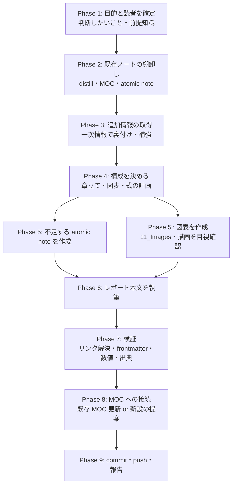

# AI運用指示書 — knowledge-base にレポートを作成するワークフロー

## このファイルの位置づけ

- 配置: `~/Github/dotfiles/shared-references`。skill `obsidian-report` から参照する。
- 役割: ある目的のために、比較的分量のある情報を1つの読み物（レポート）にまとめて `06_Reports` に置くための運用仕様。
- distill・atomic note・MOC との違い:

| 種類 | 軸 | 中身 | 置き場所 |
|---|---|---|---|
| distill | セッション（出自） | 索引＋候補メニュー | `01_Distills` |
| atomic note | 概念 | 1概念の説明本体 | `03_Atomic-notes` |
| MOC | トピック | 群別索引＋全体像 | `02_MOC` |
| **レポート** | **目的** | **目的に沿って通読できる論考。結論・根拠・考察を持つ** | `06_Reports` |

レポートは「読み物」であり、説明本体を持ってよい点で MOC と異なる。ただし個々の用語の定義・導出は atomic note に置き、レポートからリンクする（専門外の読者は、リンクをたどれば理解できる）。

- 必ず参照するファイル: `vocabulary.md`（`type: report` のキー定義）、`report-template.md`、`obsidian-rules.md`、`atomic-template.md`、`atomic-workflow.md`、`moc-workflow.md`。

---

## 0. ワークフロー全体

---

## 1. 各フェーズ

### Phase 1 — 目的と読者を確定する
- 依頼文から「誰が、何を判断するために読むのか」を1〜3文で書き出し、レポートの「目的」欄に置く。
- 読者の前提知識を想定する。専門外の読者を想定する場合は、本文で使う専門用語の一覧を作り、Phase 2・5 でリンク先を用意する。

### Phase 2 — 既存ノートの棚卸し
- `01_Distills`・`02_MOC`・`03_Atomic-notes`・`06_Reports` を、主題・同義語・英日表記で検索する。
- 過去の検討（例: 以前に退けた案、確定した結論）を読み、レポートで繰り返さず、前提として参照する。
- 再利用する atomic note と、新しく要る atomic note の一覧を作る。

### Phase 3 — 追加情報を取得する
- セッションで議論した内容に加え、目的の達成に役立つ情報を積極的に取得する（一次情報を優先: 論文・公式資料・規制当局・取引所）。
- 主張ごとに確度を付ける: **確立**（再現された知見・制度上の事実）／**文献あり**（単一または減衰が報告された研究）／**推測**（筆者の仮説）。
- 数値は、開いて確認した出典のものだけを使う。確認できなかったものは「未確認」と書く。
- 調査を並行して進める場合は、論点ごとにサブエージェントへ分け、出典 URL と確認状況を構造化して返させる。返ってきた主張は、主要なものを1つ以上自分で確かめる。

### Phase 4 — 構成を決める
- `report-template.md` の骨格（properties・タイトル・目的・要約・本文・考察・参考情報）を守る。
- 本文の章ごとに、使う図・表・式を先に決める。目安として、主要な主張1つにつき図・表・式のいずれか1つ以上を対応させる。
  - 関係・流れ → mermaid（本文に直接）
  - 数量の関係 → 計算で描いた SVG グラフ（`11_Images`）
  - 比較 → Markdown 表
  - 定量モデル → 番号付きの数式
- 図のファイル名は `<レポートの主題を短くした接頭辞>-<内容>.svg` にそろえる。

### Phase 5 — 不足する atomic note を作成する
- ユーザーがレポートの作成を依頼した時点で、レポートの理解に必要な atomic note の作成は依頼に含まれるものとして扱う（`atomic-workflow.md` の候補提示ゲートは省略し、作成した一覧を事後報告する）。
- `atomic-template.md` と `atomic-workflow.md` に従う。`source` にはレポートへのリンク（`"[[レポート名]]"`）を入れる。
- レポートで説明しきれない導出・背景は atomic note 側に寄せ、レポートの本文は目的に沿った筋に集中させる。

### Phase 5' — 図表を作成する
- SVG は自己完結（外部 CDN なし）・`width="100%"`・`viewBox` 指定・`<title>` と `<desc>` 付き・`prefers-color-scheme: dark` で文字色を切り替える形にする。既存の `11_Images/*.svg` の書式に合わせる。
- 数値のグラフは、式や乱数シードを固定したスクリプトで生成し、スクリプトは vault の外（scratch）に置く。
- ブラウザで開いて撮影し、文字の重なり・はみ出し・曲線の誤りがないか目で確かめる。

### Phase 6 — 本文を執筆する
- 「目的」→「要約」→本文→「考察」→「参考情報」の順に書く。要約は本文を書き終えてから見直し、本文と食い違わないようにする。
- 初出の専門用語は `[[atomic note]]` にリンクする（章ごとの初出にもリンクしてよい）。
- 数式は `$$...$$` と `\tag{n}` で通し番号を振り、式の後に「ここで、」と改行区切りで全変数の意味と単位を書く。`$...$` の中に日本語を入れない。
- 事実・推測・意見を分けて書く。推測には「推測」と明記する。
- 初出の略語はスペルアウトし、日本語訳を併記する。
- 本文が 2,000行・40KB を大きく超えそうなら、章を独立した付録レポートに分けてリンクする（`05_Manuals/CONTRIBUTING.md` のサイズ方針）。

### Phase 7 — 検証する
- スクリプトで、レポートと新規 atomic note のすべての `[[Wikilink]]`・`![[埋め込み]]` が vault 内の実在ファイルに解決するか、自己参照がないかを確かめる。
- frontmatter のキーと値を `vocabulary.md` と照合する。
- 本文の数値を、式や生成スクリプトの出力と照合する（例: 表の値と図の値が一致するか）。
- 参考情報の URL を開けるか確かめ、開けないものには「未確認」を付ける。

### Phase 8 — MOC へ接続する
- レポートの主題に既存 MOC があれば、その MOC の「関連」または該当する群にレポートと新規 atomic note を追加し、レポートの `moc` に設定する。
- 既存 MOC がなく、新規 atomic note が同一トピックで3枚以上になった場合は、`obsidian-moc` のヒューマンゲートに従い、群分けの草案をユーザーに提示してから作る（レポートの作成中に勝手に確定しない）。草案の提示までは本ワークフローの範囲に含める。

### Phase 9 — commit・push・報告
- vault（`ikotera/knowledge-base`）の `main` に commit・push する。コミットメッセージに、レポート名・新規 atomic note の数・図の数を書く。
- 報告には、作成・更新したファイル、確認できなかった主張、MOC の扱い（更新した／草案を提示した）を含める。

---

## 2. 落とし穴
- 追加情報の取得を省いて、セッションの議論だけをきれいに並べ直すとレポートにならない（distill と同じになる）。目的に効く外部情報を必ず足す。
- 図を描いてから本文に合わせると、図と本文の数値がずれやすい。数値は1つのスクリプトの出力を正本にし、本文・表・図はそこから写す。
- サブエージェントに atomic note を並行で書かせるときは、作成するノート名の一覧を全員に渡す。渡さないと、互いのノートへのリンクが張られないか、同じ概念が重複して作られる。
- 前の回答に誤りがあった場合は、レポートの中で訂正した形で書き、訂正したことを報告で伝える。
